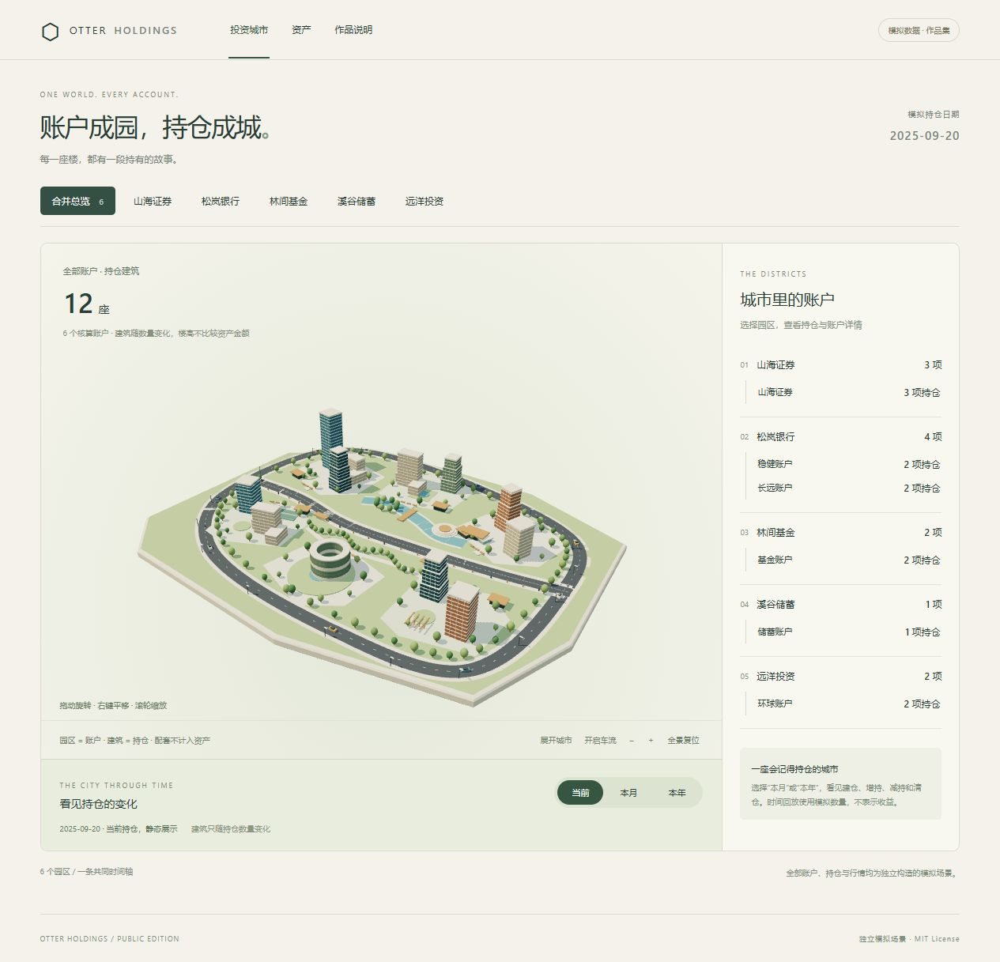
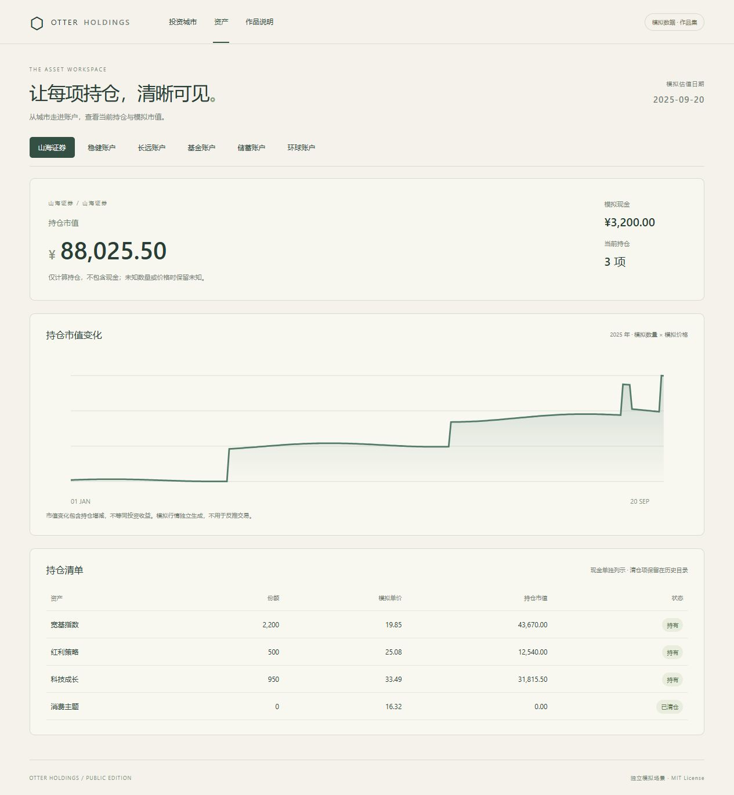

# Otter Holdings · 投资成城

**将账户化为园区，持仓化为建筑。** 一个 React + Three.js 投资可视化作品，用共同的时间轴呈现建仓、增持、减持和清仓。

[打开在线 Demo](https://tomnick777.github.io/otter-holdings/) · [工程设计](docs/architecture.md) · [MIT License](LICENSE)



## 体验

- **投资城市**：六个园区、独立地块和公共空间。拖动旋转、右键平移、滚轮缩放；也可以通过侧栏选择账户和资产。
- **持仓回放**：当前、本月、本年共用一条时间轴。暂停、继续、倍速和拖动进度；清仓后保留地块，再次买入重返原位。
- **资产工作区**：查看六账户的模拟持仓、市值曲线、份额和单价。现金独立列示，市值变化不冒充收益。
- **作品说明**：解释空间表达、财务语义和公开版边界。

所有账户、资产名称、数量变化和行情都来自独立构造的虚构场景。公开版没有真实账单、账户记录、数据库、私人资料或原项目 Git 历史；无需连接金融账户或后端服务。



## 本地运行

使用 Node.js 24+ 和 pnpm 11.7.0：

```sh
pnpm install --frozen-lockfile
pnpm dev
```

访问 `http://127.0.0.1:3518/`。修改源码后重新运行 `pnpm dev`，开发预览会先构建。

```sh
pnpm typecheck
pnpm test
pnpm build
pnpm audit:public
pnpm preview
```

`dist/` 是可以静态托管的完整网站；所有资源使用相对路径，支持 GitHub Pages 项目子目录。预览器仅绑定本机地址，只提供构建后的白名单资源。

## 工程边界

```text
独立模拟场景 → domain 数量/金额/完整性 → application 展示模型 → React / Three.js
```

- 资产身份决定地块，持仓数量决定楼高；行情不参与建筑高度计算。
- 十进制金额使用 Decimal.js；未知值保持 `null`，已知小计不标成完整合计。
- 通用计算核心保留 XIRR、Modified Dietz、严格 TWR 和区间净损益，并有独立模拟测试。
- React 负责选择与页面；Three.js 在数据或镜头变化时绘制，销毁时释放资源。WebGL 2 不可用时，账户列表和回放仍可使用。
- 不引入 Electron、SQLite、Evidence、外部字体或在线行情依赖。

## 来源与收束

原项目探索了单用户、本地优先的多账户财务工具，包括财务重建、来源追溯和明确的完整性边界。本公开版保留三维城市、数量回放与通用收益计算，整理为可复现的作品集演示。账户专属重建、真实数据导入、生产运维与旧兼容宿主已退出公开版范围。

这是已收束的展示作品，功能范围冻结。它不提供账户接入或真实财务管理服务。

## 发布

GitHub 仓库的 Pages 来源使用 **GitHub Actions**。推送到 `main` 后，工作流执行安装、类型检查、测试、构建和公开数据边界审查，再发布 `dist/`。

`pnpm audit:public` 检查文件白名单、本机路径、私有账户标识模式、凭证模式和受限制文件类型，同时检查构建产物。新场景和截图仍需人工审查，扫描通过不能替代内容来源确认。

## 许可证

MIT · Copyright © 2026 TomNick777。第三方依赖保留各自许可证，构建产物附带相应法律注释。
